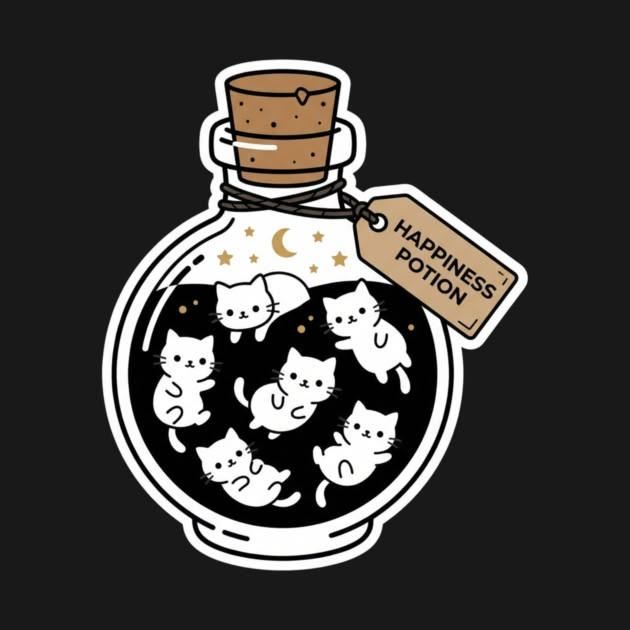

<p align="center">
  
</p>

# Plug Mimi

Claude Plugin Skill to assist a female's life.

## Installation

```bash
claude plugin marketplace add whoamimi/plugin-mimi
claude plugin install <plugin-name>@plugin-mimi
```

`code-skills` depends on Anthropic's `code-review` plugin. Add Anthropic's marketplace once before installing it, so the dependency can be installed automatically:

```bash
claude plugin marketplace add anthropics/claude-plugins-official
claude plugin install code-skills@plugin-mimi
```

## Checks

Every pull request to `main` runs these checks before it is merged automatically. Run them locally before pushing:

```bash
claude plugin validate --strict .            # marketplace and manifests
python3 scripts/lint-plugins.py              # skill authoring best practices
ruff check --select E9,F .                   # Python syntax and errors
shellcheck scripts/*.sh                      # shell scripts
scripts/update-readme-tree.sh                # keep the directory tree current
```

`scripts/lint-plugins.py` follows Anthropic's [plugin reference](https://code.claude.com/docs/en/plugins-reference) and [skill authoring best practices](https://platform.claude.com/docs/en/agents-and-tools/agent-skills/best-practices): skill names are kebab-case, at most 64 characters, match their folder and avoid reserved words; descriptions are under 1,024 characters with no XML tags and say when to use the skill; SKILL.md bodies stay under 500 lines; references stay one level deep; manifests and marketplace entries agree.

## Directory Overview

<!-- tree:start -->
```text
.
├── .claude-plugin
│   └── marketplace.json
├── .github
│   └── workflows
│       └── pr-check-and-merge.yml
├── .gitignore
├── README.md
├── SECURITY.md
├── assets
│   └── logo.png
├── plugins
│   ├── code-skills
│   │   ├── .claude-plugin
│   │   │   └── plugin.json
│   │   ├── assets
│   │   │   └── icon.png
│   │   └── skills
│   │       ├── depth-breakdown
│   │       │   └── SKILL.md
│   │       └── mimi-pr-review
│   │           └── SKILL.md
│   ├── craft-skills
│   │   ├── .claude-plugin
│   │   │   └── plugin.json
│   │   ├── assets
│   │   │   └── icon.png
│   │   └── skills
│   │       ├── get-astro-today
│   │       │   └── SKILL.md
│   │       ├── mimi-sprite-studio
│   │       │   ├── SKILL.md
│   │       │   ├── references
│   │       │   │   ├── layered-animation.md
│   │       │   │   └── mascot-styles.md
│   │       │   └── scripts
│   │       │       ├── animate.py
│   │       │       ├── cutout.py
│   │       │       └── render_svg.py
│   │       └── run-tarot-reading
│   │           ├── SKILL.md
│   │           ├── assets
│   │           │   ├── card_picker.html
│   │           │   └── deck.json
│   │           ├── references
│   │           │   ├── reading-craft.md
│   │           │   └── spreads.md
│   │           └── scripts
│   │               └── tarot.py
│   ├── life-skills
│   │   ├── .claude-plugin
│   │   │   └── plugin.json
│   │   ├── assets
│   │   │   └── icon.png
│   │   └── skills
│   │       ├── check-gmail
│   │       │   └── SKILL.md
│   │       ├── daily-decision-maker
│   │       │   └── SKILL.md
│   │       └── mimi-cbt
│   │           └── SKILL.md
│   ├── mimi-core
│   │   ├── .claude-plugin
│   │   │   └── plugin.json
│   │   ├── assets
│   │   │   └── icon.png
│   │   └── skills
│   │       ├── audit-mimis-imac
│   │       │   └── SKILL.md
│   │       ├── check-beehive
│   │       │   └── SKILL.md
│   │       ├── mimi-world
│   │       │   └── SKILL.md
│   │       └── write-readme
│   │           └── SKILL.md
│   └── soft-skills
│       ├── .claude-plugin
│       │   └── plugin.json
│       ├── assets
│       │   └── icon.png
│       └── skills
│           ├── mimi-edit
│           │   └── SKILL.md
│           ├── mimi-notes-summary
│           │   └── SKILL.md
│           ├── mimi-rephrase
│           │   └── SKILL.md
│           └── mimi-tutor
│               └── SKILL.md
└── scripts
    ├── lint-plugins.py
    └── update-readme-tree.sh
```
<!-- tree:end -->
