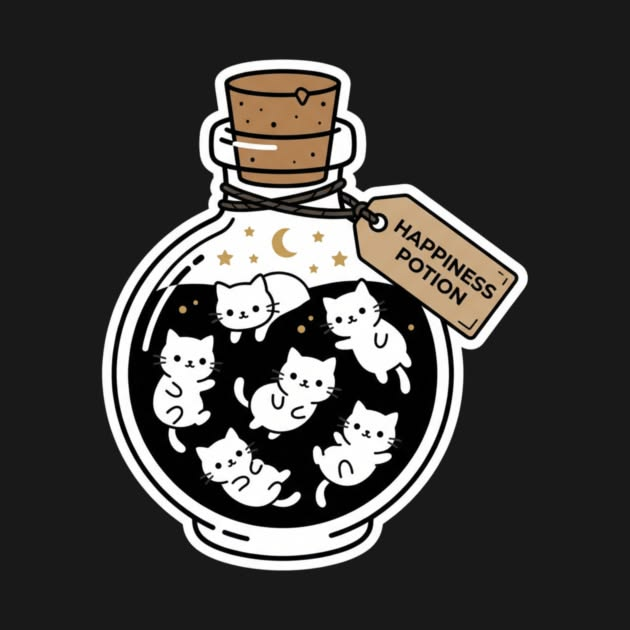

<p align="center">
  
</p>

# Plug Mimi

Claude Plugin Skill to assist a female's life.

## Installation

```bash
claude plugin marketplace add whoamimi/plugin-mimi
claude plugin install <plugin-name>@plugin-mimi
```

## Updates and versions

Each plugin pins its own `version` in `.claude-plugin/plugin.json` (never in `marketplace.json`), following semantic versioning: **major** for removed or renamed skills, **minor** for new skills, **patch** for fixes and wording. Installed plugins only update when that version changes, so every change to a plugin must bump it; the PR check enforces this. See [CHANGELOG.md](CHANGELOG.md) for what each version contains.

To receive updates automatically, open `/plugin` → **Marketplaces** → `plugin-mimi` → **Enable auto-update**. To update by hand:

```bash
claude plugin marketplace update plugin-mimi
claude plugin update <plugin-name>@plugin-mimi
```

Every released version is tagged `<plugin>--v<version>` (for example `soft-skills--v2.0.0`), the convention Claude Code uses to resolve plugin dependency version ranges. After a merge, the workflow tags new versions; to tag by hand, run `scripts/tag-releases.sh --push` on `main` (safe to repeat: it publishes any tags not yet on GitHub and never moves an existing one).

## Checks

Every pull request to `main` runs these checks before it is merged automatically. Run them locally before pushing:

```bash
claude plugin validate --strict .            # marketplace and manifests
python3 scripts/lint-plugins.py --base origin/main  # skill best practices + version bumps
ruff check --select E9,F .                   # Python syntax and errors
shellcheck scripts/*.sh plugins/*/skills/*/templates/{pre-commit,commit-msg}   # shell scripts and hook templates
scripts/update-readme-tree.sh                # keep the directory tree current
```

`scripts/lint-plugins.py` follows Anthropic's [plugin reference](https://code.claude.com/docs/en/plugins-reference) and [skill authoring best practices](https://platform.claude.com/docs/en/agents-and-tools/agent-skills/best-practices): skill names are kebab-case, at most 64 characters, match their folder and avoid reserved words; descriptions are under 1,024 characters with no XML tags, say when to use the skill and quote example requests; SKILL.md bodies stay under 500 lines; references stay one level deep; manifest names match their marketplace entries; versions are `MAJOR.MINOR.PATCH`, live only in `plugin.json`, and rise whenever a plugin changes (with `--base`).

## Directory Overview

<!-- tree:start -->
```text
.
├── .claude-plugin
│   └── marketplace.json
├── .github
│   └── workflows
│       └── pr-check-and-merge.yml
├── .gitignore
├── CHANGELOG.md
├── README.md
├── SECURITY.md
├── assets
│   └── logo.png
├── plugins
│   ├── code-skills
│   │   ├── .claude-plugin
│   │   │   └── plugin.json
│   │   ├── assets
│   │   │   └── icon.png
│   │   └── skills
│   │       ├── backup-project
│   │       │   └── SKILL.md
│   │       ├── depth-breakdown
│   │       │   └── SKILL.md
│   │       ├── get-started
│   │       │   └── SKILL.md
│   │       ├── git-repository-setup
│   │       │   ├── SKILL.md
│   │       │   └── templates
│   │       │       ├── ci-node.yml
│   │       │       ├── ci-python.yml
│   │       │       ├── commit-msg
│   │       │       ├── dependabot.yml
│   │       │       ├── gitattributes
│   │       │       ├── pre-commit
│   │       │       ├── pull_request_template.md
│   │       │       └── ruleset-main.json
│   │       ├── mimi-cyber
│   │       │   ├── SKILL.md
│   │       │   ├── ai_categories.md
│   │       │   ├── ai_tags.md
│   │       │   ├── attack_categories.md
│   │       │   ├── attack_tags.md
│   │       │   ├── commands
│   │       │   │   ├── display-cyber.md
│   │       │   │   └── update-meta-catalog.md
│   │       │   ├── resources
│   │       │   │   ├── articles
│   │       │   │   │   ├── 2026-10-linux-infrastructure-campaign.md
│   │       │   │   │   └── 2026-10-prompt-injection.md
│   │       │   │   └── scripts
│   │       │   │       ├── actors.yml
│   │       │   │       ├── attacks.yml
│   │       │   │       ├── checks.yml
│   │       │   │       ├── strategy.yml
│   │       │   │       └── update_catalog.py
│   │       │   ├── security_categories.md
│   │       │   └── security_tags.md
│   │       └── write-readme
│   │           └── SKILL.md
│   ├── craft-skills
│   │   ├── .claude-plugin
│   │   │   └── plugin.json
│   │   ├── assets
│   │   │   └── icon.png
│   │   └── skills
│   │       ├── create-brand-assets
│   │       │   ├── SKILL.md
│   │       │   ├── examples
│   │       │   │   └── discord-cozy-grove
│   │       │   │       ├── cozy_grove
│   │       │   │       │   ├── README.md
│   │       │   │       │   ├── __init__.py
│   │       │   │       │   ├── __main__.py
│   │       │   │       │   ├── assets
│   │       │   │       │   │   ├── banner_event.gif
│   │       │   │       │   │   ├── banner_news.gif
│   │       │   │       │   │   ├── banner_rules.gif
│   │       │   │       │   │   ├── banner_welcome.gif
│   │       │   │       │   │   ├── cat_idle.gif
│   │       │   │       │   │   ├── divider.gif
│   │       │   │       │   │   ├── emoji_cozy_cat.gif
│   │       │   │       │   │   ├── emoji_cozy_cat.png
│   │       │   │       │   │   ├── emoji_mushroom.png
│   │       │   │       │   │   ├── emoji_orange.png
│   │       │   │       │   │   ├── emoji_sprout.png
│   │       │   │       │   │   └── icon_leaf.png
│   │       │   │       │   ├── make_assets.py
│   │       │   │       │   └── style.py
│   │       │   │       └── preview.png
│   │       │   ├── profiles
│   │       │   │   ├── TEMPLATE.md
│   │       │   │   ├── discord-bot.json
│   │       │   │   ├── discord-bot.md
│   │       │   │   ├── google-play.json
│   │       │   │   └── google-play.md
│   │       │   ├── references
│   │       │   │   └── style-brief.md
│   │       │   └── scripts
│   │       │       ├── check_assets.py
│   │       │       ├── contact_sheet.py
│   │       │       └── palette_from_image.py
│   │       ├── get-astro-today
│   │       │   └── SKILL.md
│   │       ├── mimi-sprite-studio
│   │       │   ├── SKILL.md
│   │       │   ├── references
│   │       │   │   ├── layered-animation.md
│   │       │   │   └── mascot-styles.md
│   │       │   └── scripts
│   │       │       ├── animate.py
│   │       │       ├── cutout.py
│   │       │       └── render_svg.py
│   │       └── run-tarot-reading
│   │           ├── SKILL.md
│   │           ├── assets
│   │           │   ├── card_picker.html
│   │           │   └── deck.json
│   │           ├── references
│   │           │   ├── reading-craft.md
│   │           │   └── spreads.md
│   │           └── scripts
│   │               └── tarot.py
│   ├── life-skills
│   │   ├── .claude-plugin
│   │   │   └── plugin.json
│   │   ├── assets
│   │   │   └── icon.png
│   │   └── skills
│   │       ├── check-gmail
│   │       │   └── SKILL.md
│   │       ├── daily-decision-maker
│   │       │   └── SKILL.md
│   │       └── mimi-cbt
│   │           └── SKILL.md
│   ├── mimi-core
│   │   ├── .claude-plugin
│   │   │   └── plugin.json
│   │   ├── assets
│   │   │   └── icon.png
│   │   └── skills
│   │       ├── audit-mimis-imac
│   │       │   └── SKILL.md
│   │       ├── check-beehive
│   │       │   └── SKILL.md
│   │       └── mimi-world
│   │           └── SKILL.md
│   └── soft-skills
│       ├── .claude-plugin
│       │   └── plugin.json
│       ├── assets
│       │   └── icon.png
│       └── skills
│           ├── mimi-edit
│           │   └── SKILL.md
│           ├── mimi-notes-summary
│           │   └── SKILL.md
│           ├── mimi-rephrase
│           │   └── SKILL.md
│           └── mimi-tutor
│               └── SKILL.md
└── scripts
    ├── lint-plugins.py
    ├── tag-releases.sh
    └── update-readme-tree.sh
```
<!-- tree:end -->
