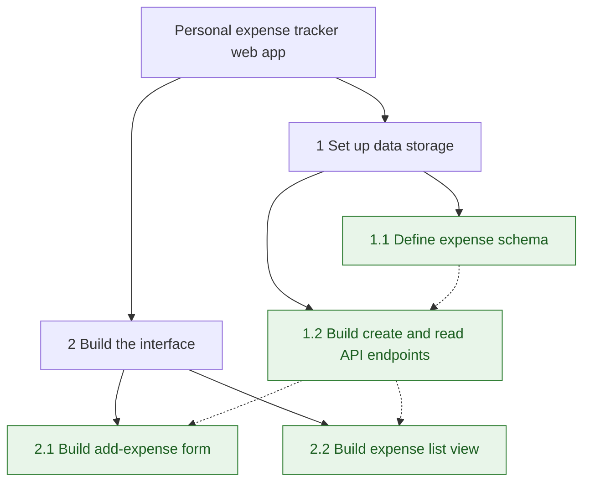
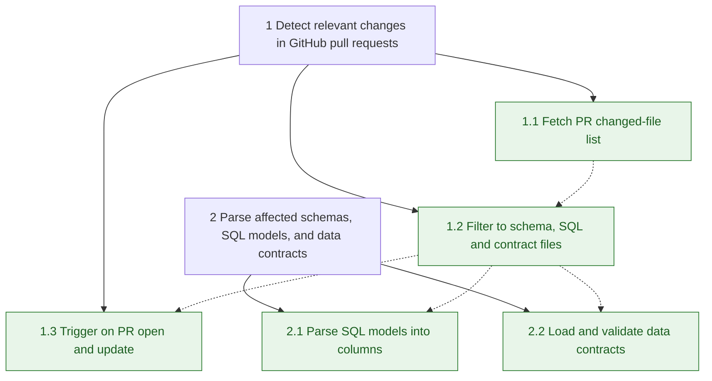

# Depth Breakdown

Decompose a project idea, or a list of steps the user already has, into progressively narrower subtasks, down to a depth the user chooses. The goal is that every lowest-level subtask (a "leaf") is something the user can build to completion in one sitting, with open-source tools named that help them do it. The breakdown is drawn as a Mermaid flowchart.

## 1. Get the inputs

- **Input**: either
  - a single **idea** (a project or feature), or
  - an existing **step list** the user has already written (numbered or bulleted).
- **Depth**: always an integer from 1 to 5.
  - 1 = one level of subtasks under each starting item.
  - 5 = up to five nested levels under each starting item.
- If depth is missing, ask once: "What depth (1-5)?" If the user does not answer or says to choose, use 3 and state that choice at the top.
- If depth is outside 1-5, say so in one line and ask for a value from 1 to 5. Do not clamp silently.
- If a single idea is too vague to split meaningfully (e.g. "an app"), ask one short question about its core purpose before starting.

## 2. Starting point

- **Single idea**: the idea is the root; depth counts levels beneath it.
- **Existing step list**: treat each given step as a top-level node (level 0). Depth counts levels **beneath each given step**, so depth 1 splits every step once.
  - Keep the user's steps, their numbering and their wording exactly. Do not merge, reorder, rename or drop them.
  - Break down **every** given step, unless the user names specific ones.
  - If a needed step seems missing, mention it in one line under "Gaps" rather than inserting it.

## 3. Decomposition rules

- Each node gets **2-5 children**. Children together must fully cover their parent; no overlap between siblings.
- Each level must be **narrower and more concrete** than the one above: goal → component → feature → task → step.
- Depth is a **maximum**, not a quota. Stop splitting a branch early once a node is already atomic (see leaf test). Never pad with trivial subtasks to reach the depth.
- Name every new node with a verb-led action ("Build login form", not "Login").
- Keep the user's stated stack, constraints and scope; do not invent features they did not ask for.

## 4. Leaf test — every leaf must pass all of these

1. **Small**: doable in roughly 1-3 hours of focused work.
2. **Complete**: produces a finished, working output (a function, endpoint, screen, query, notebook cell, doc page), not a half-step like "start researching".
3. **Verifiable**: has a clear "Done when" check the user can run or see.
4. **Independent**: can be built once its listed dependencies are done, without waiting on unrelated work.

If a leaf at the maximum depth still fails the "Small" test, keep it but mark it `⚠ large` and suggest rerunning that branch with more depth.

## 5. Open-source tools

For every leaf, name the external open-source tools the user can use to build it.

- **What counts**: libraries, CLIs, frameworks or GitHub Actions released under an OSI-approved licence, free to use.
- **How many**: 1-2 per leaf; the best fit first. Prefer tools in the user's stated stack and language.
- **Format**: `Tool name (licence) — what it does for this leaf`, e.g. `sqlglot (MIT) — parses SQL into an AST to find changed columns`.
- **Accuracy**: only name tools that genuinely exist and fit the task. If unsure whether a tool is current, maintained, or what its licence is, check with web search before naming it. Never invent a tool, package name or licence.
- **Licences**: flag copyleft licences (GPL, AGPL) with `⚠ copyleft`, since they can restrict use in commercial or closed-source work.
- **Non-open-source**: if a leaf relies on a hosted platform or proprietary service (e.g. GitHub Actions runners, a cloud API), label it `(platform)` rather than giving it a licence.
- **None needed**: if standard-library code is enough, write `Tools: standard library (<module>)`. If nothing suitable exists, write `Tools: build yourself`.

## 6. Mermaid flowchart rules

Draw the breakdown as one Mermaid flowchart in a ```mermaid code block.

- Start with `flowchart TD`.
- **Node IDs**: `root` for a single idea; `n1`, `n1_1`, `n1_1_2` … for numbered nodes (underscores, never dots, in IDs).
- **Labels**: always in double quotes, starting with the node number, e.g. `n1_1["1.1 Fetch changed files"]`. Keep labels short (under ~45 characters); put detail in Leaf details, not the chart. Do not use double quotes, `#` or `;` inside labels.
- **Hierarchy**: solid arrows from parent to child, `n1 --> n1_1`. Use `&` to fan out siblings, e.g. `n1 --> n1_1 & n1_2`.
- **Dependencies**: dashed arrows from prerequisite to dependent leaf, `n1_1 -.-> n1_2`. Only draw dependencies between leaves.
- **Leaves**: style them with a `leaf` class; mark `⚠ large` leaves with a `large` class.
- For a step list, there is no `root`; the user's steps are the top nodes, labelled with their own wording.
- For large charts (more than ~25 nodes), wrap each top-level branch in a `subgraph` so it stays readable.
- Check the code is valid Mermaid before sending; if a Mermaid validation or render tool is available, use it.

## 7. Output format

Use this structure, in order:

**Input:** <one-line restatement of the idea, or "N given steps">  
**Depth:** <n>

### Flowchart
The Mermaid code block per section 6.

### Leaf details
One entry per leaf, in number order:
- **<number> <name>**
  - `Done when:` a concrete, checkable outcome.
  - `Needs:` the leaf numbers it depends on, or `—`.
  - `Tools:` open-source tools per section 5.

### Build order
A flat numbered list of all leaves in a sensible build sequence (dependencies first, then quickest visible wins). Reference leaf numbers and names only.

### Tool summary
A deduplicated list of every tool named, each with its licence and the leaf numbers that use it, so the user can see the full set to install.

### Gaps
Only for a step list, and only if something is missing: one line per gap. Omit the section otherwise.

### First step
One sentence naming the leaf to start with and why.

## 8. Style

- Concise, plain English; no filler.
- No time estimates beyond the leaf size rule, and no extra sections beyond the format above.
- After the output, offer one follow-up: deepen a specific branch, or turn the build order into a task list.

## Example A — single idea (depth 2)

**Input:** Personal expense tracker web app  
**Depth:** 2

### Flowchart


### Leaf details
- **1.1 Define expense schema**
  - `Done when:` schema file exists and a sample record validates.
  - `Needs:` —
  - `Tools:` Pydantic (MIT) — defines and validates the schema.
- **1.2 Build create and read API endpoints**
  - `Done when:` POST then GET returns the saved expense.
  - `Needs:` 1.1
  - `Tools:` FastAPI (MIT) — serves the endpoints; standard library (sqlite3) — stores records.
- **2.1 Build add-expense form**
  - `Done when:` submitting the form stores a record via the API.
  - `Needs:` 1.2
  - `Tools:` React (MIT) — renders the form.
- **2.2 Build expense list view**
  - `Done when:` saved expenses appear sorted by date.
  - `Needs:` 1.2
  - `Tools:` React (MIT) — renders the list.

### Build order
1. 1.1 Define expense schema
2. 1.2 Build create and read API endpoints
3. 2.1 Build add-expense form
4. 2.2 Build expense list view

### Tool summary
- Pydantic (MIT) — 1.1
- FastAPI (MIT) — 1.2
- React (MIT) — 2.1, 2.2

### First step
Start with 1.1, because every other piece reads or writes that schema.

## Example B — existing step list (depth 1, first two steps shown)

User gives: "1. Detect relevant changes in GitHub pull requests. 2. Parse affected schemas, SQL models, and data contracts. …"

### Flowchart


### Leaf details
- **1.1 Fetch PR changed-file list**
  - `Done when:` running it on a test PR prints every changed path.
  - `Needs:` —
  - `Tools:` PyGithub (LGPL-3.0) — wraps the GitHub REST API.
- **1.2 Filter to schema, SQL and contract files**
  - `Done when:` a fixture list of mixed paths returns only the relevant ones.
  - `Needs:` 1.1
  - `Tools:` pathspec (MPL-2.0) — matches gitignore-style path patterns.
- **1.3 Trigger on PR open and update**
  - `Done when:` opening a test PR runs 1.1-1.2 automatically.
  - `Needs:` 1.2
  - `Tools:` GitHub Actions (platform) — runs the job on pull_request events.
- **2.1 Parse SQL models into columns**
  - `Done when:` a sample model returns its tables and columns.
  - `Needs:` 1.2
  - `Tools:` sqlglot (MIT) — parses SQL across dialects, including Databricks.
- **2.2 Load and validate data contracts**
  - `Done when:` a sample contract loads and an invalid one raises an error.
  - `Needs:` 1.2
  - `Tools:` datacontract-cli (MIT) — reads and lints Data Contract specification files.

… (remaining steps follow the same pattern)